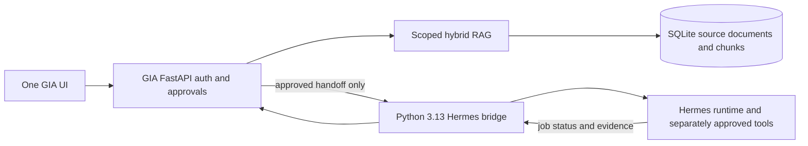

# Updated ZIP, GIA v14, Hermes, and RAG Vector Integration Audit

> Historical source-comparison report. The user-directed final build is GIA-only: it carries selected portable skill procedures and local HRR memory into GIA, keeps GIA's existing SQLite RAG/memory, and does not include or call the Hermes runtime. Pinecone/Chroma guidance in this historical report is not enabled.

Audit date: 2026-10-24 (Asia/Kolkata)

## Scope

Compared the workspace ZIP `GIA-v14-CANONICAL-WORKTREE-SINGLE (8).zip` with the existing `giav14-main` folder last modified on 2026-10-21, inspected the extracted ZIP candidate, and reviewed `GIA-hermes-agent-main`. The user's Google AI Studio project is linked from the candidate UI but its source/export is not in the workspace.

## ZIP versus the 21-Oct GIA folder

The workspace ZIP has SHA-256 `A75DB284C18D6E37DB509375DB081919A48AC4BCB09AA977A3263CE30D58DC8C`, the same archive hash recorded in the earlier audit. The ZIP contains 238 entries, including the GIA source tree and its source hash manifest.

After excluding dependency and cache folders, the current 21-Oct `giav14-main` has 151 files and the ZIP's `giav14-main` tree has 231:

| Comparison result | Files |
|---|---:|
| Same path and SHA-256 | 117 |
| Same path, different content | 32 |
| Only in the 21-Oct folder | 2 |
| Only in the ZIP | 82 |

Important ZIP additions include the SQLite repository (`backend/app/db/sqlite.py`), the Hermes client and gated API route (`backend/app/integrations/hermes.py`, `backend/app/routes/hermes_integration.py`), the Studio API/UI, the RAG retriever, the opt-in model-only provider adapter, and their tests/docs. The originals remain separate; the extracted candidate is the right comparison/build base.

## RAG location and vector status

The active implementation is **not** the top-level `rag/` folder:

- `rag/README.md` only says `rag boundary`.
- Active routes are in `backend/app/routes/rag.py`.
- Active storage/retrieval is in `backend/app/rag/store.py` and `backend/app/rag/retriever.py`.
- Persistence uses `backend/app/db/sqlite.py`.

The 21-Oct folder's RAG and memory stores use process-local dictionaries. In the updated ZIP, RAG chunks, document text, source versions, tags, and project memory are persisted in SQLite and scoped by user/project. Search is lexical term scoring with chunk overlap and metadata; it is not vector search. The ZIP's P6 report explicitly says Gemini embeddings and cosine-similarity retrieval were not ported. No vector database, embedding index, or embedding implementation was found in the executable GIA source. Hermes contains model/embedding references, but no RAG vector index that can be dropped into this app.

This corrects the earlier audit wording: the process-local RAG/memory statement applies to the 21-Oct folder, not to the updated ZIP candidate.

## Hermes integration status

The ZIP already has the **GIA side** of an optional bridge:

- `HERMES_ADAPTER_URL` and `HERMES_ADAPTER_TOKEN` configure it; both unset means disabled.
- GIA requires an authenticated owner and a persisted, explicitly approved task before handoff.
- The envelope is `handoff_only`, requires remote approval, and carries a restricted action list; the endpoint writes audit events.
- The GIA client expects a bridge `GET /health` and `POST /tasks` contract. It is not a Hermes-runtime import.

The workspace Hermes source is a separate full runtime, version 0.21.3, with `requires-python >=3.11,<3.14`. The local Python 3.14.7 is outside that declared range. Its dashboard exposes its own authenticated API (including `/api/health`) and its own task/chat surfaces; I found no endpoint directly matching GIA's bridge contract. A small compatibility bridge is therefore still required. No live Hermes service or bridge was running during this audit.

GIA's 12 agent entries are role profiles. Its opt-in provider adapter is disabled by default, model-only, and does not attach personal RAG or grant tools. Hermes is the separate runtime/tools layer; the two do not become one autonomous brain merely because both source trees are present.

## Recommended combined design

Keep the updated ZIP candidate as the single GIA UI/API shell. Keep its SQLite records as the canonical source of RAG documents and chunks. Add vector retrieval behind `backend/app/rag/` as an optional hybrid layer:

1. Define an embedding-provider interface and configuration; disabled by default until a provider/model is chosen and credentials are supplied through environment configuration.
2. Store vectors with `chunk_id`, `user_id`, `project_id`, model/version, and dimensions. Re-indexing, document versioning, and deletion must update the vector index consistently with SQLite source records.
3. Keep lexical retrieval as the offline fallback and combine lexical/vector scores only after retrieval quality tests. Return source/version identifiers so the answer can cite the indexed document.
4. Pass only the requesting user's current project-scoped retrieved context to an explicitly configured model/Hermes handoff. Do not attach every memory or all workspace data by default.

Run Hermes in a separate Python 3.13 environment/service. Add a narrow bridge that implements GIA's existing `/health` and `/tasks` contract, translates the minimal handoff into a Hermes run, and returns accepted/job status. Preserve a separate remote approval in Hermes before tool execution, with a tool/skill allowlist, timeouts, cancellation, per-user/project ownership mapping, and audit records. Never expose Hermes directly to the browser.

## Verification and remaining decisions

- Current RAG persistence, P6 RAG/memory, Hermes handoff policy, and provider-adapter tests: **23 passed** using temporary database/audit paths. One Starlette/httpx deprecation warning remains.
- Those Hermes tests mock the bridge. They do not prove the Hermes source starts on this host or accepts GIA's contract.
- No live embedding provider was configured or called. Vector quality, model selection, dimensions, retention, and cost are not verified.
- Next implementation order: build the embedding provider/store behind the existing SQLite RAG boundary; build the isolated Hermes compatibility bridge; run restart, tenant-isolation, no-provider fallback, approval, and end-to-end handoff tests.
